<!--  linter settings:
//  jshint -W061 -->

# PROMO GNEWS

**pt-BR** ⚡ extensão do After Effects com as ferramentas da equipe de motion em PROMO na 

After Effects 2022 ou mais novo, no Windows e no macOS: uma barra em sanfona (vertical ou horizontal) com as ferramentas e janelas próprias para as tarefas maiores.

| barra | curvas | busca | templates | fontes |
| :---: | :---: | :---: | :---: | :---: |
|  |  |  |  |  |

| preferências | tags | end page | labels |
| :---: | :---: | :---: | :---: |
|  |  |  |  |

na horizontal, quando o painel é baixo e largo:


## instalar

na pasta do PROMO GNEWS na rede, rode `INSTALAR PROMO GNEWS.jsx` em *File › Scripts › Run Script File…*. detalhes, desenvolvimento e estrutura do código em [cep/README.md](/cep/README.md).

## seções

```markdown
    - [controles]   →   hierarquias, nulls e afins...
    - [animação]
    - [efeitos]
    - [texto]       →   manipulação de layers de texto...
    - [marca]       →   logos, cores e elementos do on-air atual...
    - [projeto]     →   organiza tudo em pastinhas...
    - [atalhos]
    - [programa]    →   configurações do after, media encoder, fontes...
    - [dev]         →   ferramentas de desenvolvimento...
    rodapé          →   templates, busca, preview, preferências e seleção atual
```

> as seções abaixo descrevem cada ferramenta. os ícones são os da primeira versão do script; a ferramenta é a mesma na barra nova.

---

<br /><br />

# 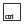 [ seção *controles* ]

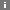 → abre a documentação | ajuda da seção.

---
<br />

##  botão **`null`**

cria um 'null' pai na mesma posição de cada layer selecionado.

> caso não tenha nenhum layer selecionado, o *'null'* é criado no centro da tela.\
> o tipo de layer usado como *'null'* pode ser configurado nas *'preferências'* como *'solid'* ou *'shape layer'*...

1. ### 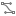 modificador **`copiar animação`**

    habilita a transferência dos 'key frames' de transformação dos layers selecionados para o 'null'.

    ```markdown
        'anchor point'
        'posição'
        'escala'
        'rotação'
    ```

    > os *'key frames'* de *'opacidade'* não serão transferidos...

    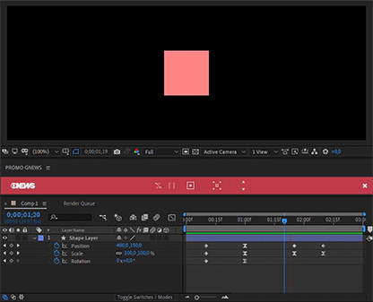

2. ### 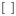 modificador **`copiar expressões`**

    habilita a transferência das 'expressões' de transformação dos layers selecionados para o 'null'.

    ```markdown
        'anchor point'
        'posição'
        'escala'
        'rotação'
    ```

    > as *'expressões'* de *'opacidade'* não serão transferidas...
<!-- [ ] ex: copiar expressões -->
---
<br />

### 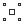 botão **`null central`**

cria um único 'null' pai no 'centro geométrico' de 2 ou mais layers selecionados.

---
<br />

### 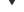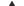 botões de **`seleção de hierarquia`**

avança pela `hierarquia` dos layers selecionados... seleciona o pai ou todos os filhos.

<!-- [ ] ex: seleção de hierarquia -->
---

<br /><br />

# 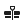 [ seção *animação* ]

 → abre a documentação | ajuda da seção.

---
<br />

## 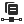 botão **`copiar influência`**

copia as seguintes propriedades do keyframe selecionado:

```markdown
    ↑ influência de entrada
    ↑ influência de saída
    ↑ velocidade de entrada
    ↑ velocidade de saída
```

###   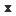       keyframe stats

    info sobre as propriedades copiadas do keyframe selecionado

##  botão **`colar influência`**

substitui as seguintes propriedades do keyframe selecionado:

```markdown
    ↓ influência de entrada
    ↓ influência de saída
    ↓ velocidade de entrada
    ↓ velocidade de saída
```

<!-- [ ] ex: copiar e colar influencias -->
---
<br />

## 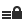 botão **`trancar`**

tranca todas as propriedades de transformação não animadas dos layers selecionados.
<!---
    
--->
```markdown
    'anchor point'
    'posição'
    'escala'
    'rotação'
    'opacidade'
```
<!-- [ ] ex: bloquear propriedades de transformação -->
---
<br />

## 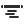 botão **`randomizar layers`**

avança e atrasa os tempos de entrada e saída de cada layer selecionado entre o primeiro e último tempos de entrada.
> caso os layers selecionados tenham o mesmo tempo de entrada todos serão deslocados entre 0 e 1 segundo.
<!-- [ ] ex: randomizar layers -->
---
<br /><br />

# 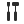 [ subseção **`ferramentas`** ]

 → abre a documentação | ajuda da seção.

---
<br />

## 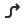 botão **`seta`**

preset de seta com controles diversos.
> configurações da janela de *'controle de efeito'*...\
> [documentação completa](/docs/doc.md)
<!-- [ ] ex: seleção de hierarquia -->
---
<br />

## 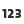 botão **`counter`**

cria rig de contagem usando um layer de texto.

```markdown
    ex: colocando os seguintes parâmetros...

        'modo' = número
        'deslocamento' = 0% >>> 100% [animado]
        'valor inicial' = -10
        'valor final' = 10

        o layer de texto será animado indo de '-10' a '10'.
```

> cada modo possui configurações na janela de *'controle de efeito'*...\
> [documentação completa](/docs/doc.md)

##  botão **`digitação`**

lettering com animação padrão estilo digitação.
> configurações da janela de *'controle de efeito'*...\
> [documentação completa](/docs/doc.md)
<!-- [ ] ex: typewriter -->

##  botão **`palavras`**

lettering com animação padrão palavra por palavra.
> configurações da janela de *'controle de efeito'*...\
> [documentação completa](/docs/doc.md)
<!-- [ ] ex: words -->

##  botão **`tarja simples`**

cria uma tarja simples no layer selecionado.

---
<br />

## 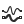 botão **`wig`**

cria um rig simples de movimento usando a expressão 'wiggle' na 'posição' dos layers selecionados.
> configurações na janela de *'controle de efeito'*...\
> [documentação completa](/docs/doc.md)
<!-- [ ] ex: wig -->

---
<br />

## 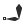 botão **`ik`**

cria um rig simples de movimento usando cinemática inversa com 3 layers selecionados em ordem.

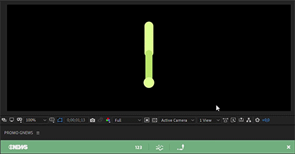
> a 'ordem' de seleção deverá seguir a 'ordem' da hierarquia pretendida...

```markdown
    ex: para o rig de uma perna a ordem de seleção seria...
        1 - coxa
        2 - canela
        3 - pé
```

---

<br /><br />

# 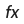 [ seção *efeitos* ]

 → abre a documentação | ajuda da seção.

---
<br />

## 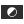 botão **`adjustment layer`**

cria um 'adjustment layer' responsivo com as dimensões da composição.

> o tipo de layer usado como *'adjustment layer'* pode ser configurado nas *'preferências'* como *'solid'* ou *'shape layer'*...

## 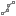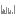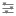  botões **`correção de cor`**

```markdown
    efeitos: 'curves'
             'levels'
             'lumetri color'
```

---

<br /><br />

# 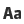 [ seção *texto* ]

 → abre a documentação | ajuda da seção.

---
<br />

##  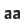  botões de caixa **`ALTA`**, **`baixa`** e **`Título`**

converte todo o conteúdo dos layers de texto selecionados.

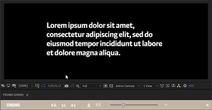

## 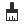 botão **`limpar texto`**

remove múltiplos espaços consecutivos, quebras de linha e faz o trim do layer de texto.
<!-- [ ] ex: limpador de texto -->

##  botão **`separar colunas`**

separa um layer de texto em 2 ou mais colunas cada coluna gera um novo layer de texto .

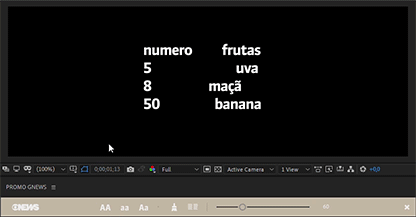

---
<br />

## 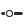 **`quebra linhas`**

estabelece um limite de caracteres por linha e quebra o texto assim que esse limite é ultrapassado.

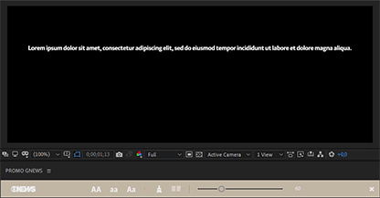

---

<br /><br />

#  [ seção *marca* ]

 → abre a documentação | ajuda da seção.

---
<br />

## botões **`paleta GNEWS`**

aplica um efeito 'fill' com a cor selecionada.
  
| cor                                 | rgb           | #hex    |
| ----------------------------------- | ------------- | ------- |
| 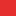 | 229, 49, 49   | #E52F2E |
| 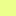 | 238, 255, 140 | #ECFF8C |
|  | 35, 30, 30    | #221E1D |

| cor                                 | rgb           | #hex    |
| ----------------------------------- | ------------- | ------- |
| 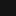 | 20, 20, 20    | #141414 |
|  | 51, 51, 51    | #333333 |
| 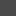 | 74, 74, 74    | #4A4A4A |
| 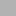 | 178, 178, 178 | #B2B2B2 |
|  | 242, 242, 242 | #F2F2F2 |

| cor                                 | rgb           | #hex    |
| ----------------------------------- | ------------- | ------- |
| 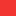 | 242, 51, 51   | #F13333 |
| 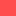 | 255, 77, 77   | #FF4D4D |
| 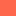 | 255, 103, 77  | #FE674C |
| 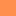 | 255, 143, 77  | #FF8F4D |
| 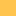 | 255, 196, 78  | #FFC44E |
|  | 255, 90, 103  | #FF5A68 |
| 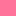 | 255, 115, 154 | #FF739A |
| 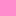 | 255, 140, 205 | #FF8CCD |
| 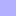 | 181, 173, 255 | #B5ADFF |
|  | 128, 192, 255 | #80C0FE |
| 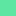 | 92, 230, 161  | #5DE6A2 |

## 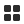 botão **`paleta`**

cria um 'shape layer' com amostras da paleta.
> guide layer e bloqueado.
<!-- [ ] ex: paleta shape layer -->

---
<br />

## 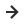 botão **`seta on-air`**

cria um 'shape layer' com a seta usada no on-air.

##  botão **`logo estático`**

cria um 'shape layer' com a logo GNEWS estática.

## 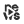 botão **`logo animado`**

cria um 'shape layer' com a logo GNEWS animada.
> animação padrão de 3 segundos.\
> a animação iniciará no tempo atual da comp selecionada.
<!-- [ ] ex: logo animado -->

---

<br /><br />
<!-- 
##  *renomear / sequenciar layers*
### botão **`renomear`**
renomeia todos os layers dos tipos habilitados.
- adiciona um 'prefixo' padrão.
- converte o nome para 'caixa baixa'.
- remove 'caracteres especiais'.
> no caso dos layers de texto o próprio conteúdo será usado como nome.
```markdown
    ex: um layer de texto contendo
        'Dia 8 às 20H' seria renomeado como 'txt_dia 8 as 20h'.
```
> USE COM CAUTELA RENOMEAR LAYERS PODE FERRAR COM SUAS *'EXPRESSÕES'*!!!
1. ###       modificadores **`tipos de layer`**
    habilita os tipos de layers que podem ser renomeados.
    | tipos de layer | prefixo padrão |
    | -------------- | -------------- |
    | footage        | ftg            |
    | solids         | sol            |
    | shapes         | shp            |
    | textos         | txt            |
    | cameras        | cam            |
    | luzes          | lgt            |
###  botão **`isolar`**
habilita o 'shy' e esconde todos os layers selecionados.
---
<br /> -->

#  [ seção *projeto* ]

 → abre a documentação | ajuda da seção.

---
<br />

## 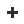 botão **`adicionar retranca`**

adiciona os seguintes itens do padrão de nomenclatura de promo no nome de cada comp selecionada:

- id do usuário > *3 primeiras letras do usuário logado na máquina.*
- tag 'PROMO' > *PROMO*
- id do projeto > *sigla de 3 letras do produto + 6 números da data*
<!-- [ ] ex: adicionar retranca -->

```markdown
    ex: usando as seguintes informações ficaria...

        1 - usuário: jbillard → 'JBI'
        2 - tag: 'PROMO'
        3 - id do projeto: Edição das 16H - dia 20/07/22 → 'E16200722'

        'comp1' seria renomeada para 'JBI PROMO - E16200722 comp1'.
```

> consulte a tabela de retrancas de *'PROMO'* para ver a lista completa de siglas dos produtos...

##  botão **`renomear templates`**

renomeia as comps de templates e assinaturas de chamada seguindo o padrão de nomenclatura de promo.

- id do usuário > *3 primeiras letras do usuário logado na máquina.*
- tag 'PROMO' > *PROMO*
- id do projeto > *sigla de 3 letras do produto + 6 números da data*
- nome do projeto > *nome do projeto descrito no 'trello' de promo*
- serviço > *data e horário das versões em forma reduzida*
  
```markdown
    ex: usando as seguintes informações ficaria...

        1 - usuário: rdenoni → 'RDE'
        2 - tag: 'PROMO'
        3 - id do projeto: GNEWS Internacional - dia 15/03/22 > 'INT150322'
        4 - nome do projeto: 'institucional'
        5 - serviço: Quinta-feira - 22:00 → 'QUI 22H'

        o template seria renomeado para 'RDE PROMO - INT150322 institucional QUI 22H'.
```
<!-- [ ] ex: renomear template -->

---
<br />

##  botão **`organizar projeto`**

cria e organiza a estrutura do projeto seguindo o modelo de projeto.
> modelo de projeto pode ser alterado nas *'preferências do script'*...
<!-- [ ] ex: organizar projeto -->

> click direito -> aplica tags de organização nos itens selecionados da *'janela de projeto'*.

-  exportar
-  editar
-  ignorar
-  fundo
-  foto
-  ref
-  logo
-  ícone
-  textura
-  padrão
-  módulo
-  tarja
-  música
-  locução
-  assinatura *'end page'*
-  abertura

---
<br />

##  botão **`modelos de assinatura`**

seleciona, modifica, aplica e salva modelos do template de assinatura *'end page'*.
> [documentação completa](/docs/doc.md)
<!-- [ ] ex: modelos de assinatura -->

---
<br />

##  botão **`salvar projeto`**

abre a janela de seleção de caminho do 'sistema' e salva o projeto usando o padrão de nomenclatura de promo.

- id do projeto > *sigla de 3 letras do produto + 6 números da data*
- nome do projeto > *nome do projeto descrito no 'trello' de promo*

 ```markdown
    ex: usando as seguintes informações ficaria...

        1 - id do projeto: Marketing - dia 08/11/22 → 'MKT081122'
        2 - nome do projeto: 'video comercial'

        o projeto seria renomeado para 'MKT081122 video comercial'.
```

1. ###  modificador **`coletar arquivos`**

    habilita a coleta de todos os arquivos usados no projeto quando salvo.
    > 'collect files'...

2. ###  modificador **`coletar fontes`**

    habilita a coleta de todas as fontes usadas no projeto quando salvo.
    > limitação da *Adobe*: apenas as fontes instaladas na pasta de fontes do 'sistema' podem ser copiadas...

---

<br /><br />

#  [ seção *atalhos* ]

 → abre a documentação | ajuda da seção.

---
<br />

## botões **`office globo`**

[**`oneDrive`**](https://tvglobocorp-my.sharepoint.com/)

acessa o oneDrive da conta 'globo'.

```markdown
    urls: 'https://tvglobocorp-my.sharepoint.com/'
```

## botões **`work flow`**

[**`trello`**](https://trello.com/promo126/home)
[**`typeForm`**](https://tvglobo.typeform.com/to/wiqX4z0X)
[**`planner`**](https://tvglobocorp.sharepoint.com/sites/IlhadeEdioPromo_GNews/Documentos%20Compartilhados/Forms/AllItems.aspx)

acessam as plataformas que a 'globo' e a equipe de 'promo' usam para gerenciar tarefas.

```markdown
    urls: 'https://trello.com/promo126/home'
          'https://tvglobo.typeform.com/to/wiqX4z0X'
          'https://tasks.office.com/tvglobocorp.onmicrosoft.com/en-US/Home/Planner/#/userboard'
```

---
<br />

## botões **`rede`**

**`para ARTE`**\
**`upload MAGAZINE`**\
**`upload HARD NEWS`**\
**`N:\UTILIDADES`**\
**`_Bases Jornais`**\
**`PRODUCAO DIA-A-DIA\...\[Hoje]`**

acessam as pastas na rede da 'globo'.

> um caminho personalizado para as pastas *'para ARTE'* e *'upload MAGAZINE'* pode ser configurado nas *'preferências do script'*...

---

<br /><br />

#  janela **`templates`**

baixa e exibe os principais templates dos projetos de 'PROMO'.

> download: *'~\AppData\Roaming\PROMO GNEWS script\templates'*\
> [documentação completa](/docs/doc.md)

---

<br /><br />

#  janela **`busca`**

executa uma busca pelo termo pesquisado no conteúdo dos *'text layers'*.

> caso nenhuma composição esteja selecionada na *'janela de projeto'*, a busca englobará todas as composições.\
> [documentação completa](/docs/doc.md)

---

<br /><br />

#  botão **`preview`**

exporta o frame atual da comp selecionada em *'.png'*.

> por padrão o arquivo será nomeado como *'**nome da comp** preview.png'*.

---

<br /><br />

#  [ seção *programa* ]

 → abre a documentação | ajuda da seção.

---
<br />

##  botão **`fontes`**

baixa e instala as fontes do *'ON-AIR'* entre outras.

- Degular
- Suisse

> download: *'~\AppData\Roaming\PROMO GNEWS script\fonts'*\
> [documentação completa](/docs/doc.md)

---
<br />

##  botão **`AME presets`**

baixa e instala os principais presets de 'PROMO' no 'Media Encoder'.

- H264 - mp4 alta.epr
- H264 - mp4 baixa.epr
- WAV - audio GSAT.epr
- XDCAM HD 50 NTSC 60i - avid.epr

> download: *'~\AppData\Roaming\PROMO GNEWS script\AME presets'*\
> instalação: *'~\Documents\Adobe\Adobe Media Encoder\versão instalada\Presets'*

---

<br /><br />

#  janela *preferencias*

> [documentação completa](/docs/preferences.md)
