# PROMO GNEWS · v3 beta 1

**pt-BR** ⚡ extensão do After Effects com as ferramentas da equipe de motion em PROMO na 

Funciona no After Effects 2022 ou mais novo, no **Windows e no macOS**. É uma barra em sanfona com as ferramentas do dia a dia, mais janelas próprias para as tarefas maiores.

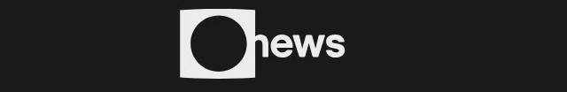

- [instalar](#instalar)
- [primeiros passos](#primeiros-passos)
- [seções e ferramentas](#seções-e-ferramentas)
- [janelas](#janelas)
- [preferências](#preferências)
- [desenvolvimento](#desenvolvimento)

---

## instalar

1. Abra o After Effects e vá em *File › Scripts › Run Script File…*.
2. Escolha `INSTALAR PROMO GNEWS.jsx`, na pasta do PROMO GNEWS na rede (a pasta que tem `cep` e `source`).
3. Se tudo estiver ok, o instalador abre direto em **instalar** / **atualizar**. Se faltar algo, ele mostra o quê e onde procurou. Se a pasta não for encontrada, use **› escolher a pasta do PROMO GNEWS…**.
4. Reinicie o After Effects e abra *Window › Extensions › PROMO GNEWS*.

O instalador também encontra a barra antiga (ScriptUI) e oferece removê-la. Enquanto ela estiver instalada, a bolinha do indicador fica vermelha.

> O código fica na rede. Para atualizar, basta trocar os arquivos lá e reabrir o painel; o instalador só precisa rodar de novo quando a equipe avisar (**na v3 beta 1, rode de novo**).\
> Se algo parecer antigo, rode `tools/diagnostico.jsx` (*Run Script File…*): ele lista as cópias instaladas e aponta as desatualizadas.

---

## primeiros passos

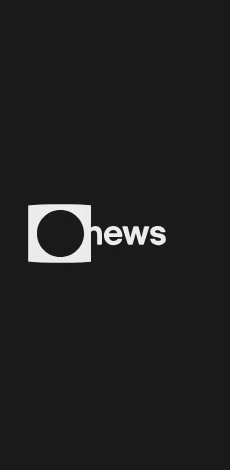

**1. Abra uma seção.** Cada seção tem um ícone e uma cor. Clique no ícone ou no nome dela: a linha da seção aberta fica na cor da seção e as ferramentas aparecem logo abaixo. Clique de novo para fechar. Só uma seção fica aberta por vez.

**2. Pare o mouse sobre um botão.** Um quadradinho amarelo sobe e o nome da ferramenta aparece digitado. Quando existe, a linha **◗** mostra o que o botão direito faz.

**3. Selecione e clique.** As ferramentas trabalham no que está selecionado no After Effects: layers na timeline ou comps no painel de projeto. Quando falta o que é preciso, o botão fica apagado. Por exemplo, **Null centralizado** só acende com 2 layers ou mais. O resultado aparece numa linha curta no rodapé, e tudo pode ser desfeito com *Ctrl/Cmd + Z*.

**4. Use o botão direito.** Algumas ferramentas têm uma variação no botão direito:
- **Randomizar** e **Sequenciar** abrem um campo para ajustar os frames.
- **Organizar projeto** abre as tags de organização.
- **Setup da comp** cria a comp na vertical.
- Nos atalhos, cores e efeitos, o botão direito abre as preferências já no item, para editar.

**5. Acompanhe as tarefas longas.** Organizar, salvar, coletar e o lote mostram o progresso:
- no próprio botão;
- numa linha no rodapé;
- na porcentagem do indicador de seleção.

Clique no botão de novo para **cancelar**.

 

**Indicador de seleção** (canto da barra):
- mostra quantos layers estão selecionados;
- fica verde quando há uma comp ativa;
- a **bolinha vermelha** avisa que a rede está fora ou que a barra antiga ainda está instalada. O motivo aparece no tooltip.

**Formato da barra.** Redimensione o painel e o layout acompanha:

| estreita | larga |
| :---: | :---: |
|  |  |
| ícones em 3 colunas, nomes curtos | ícones com o nome inteiro |

**horizontal** — painel baixo e largo: 1 ou 2 linhas de ferramentas por seção.

**Logo.** A logo da GNEWS abre a barra com a animação oficial. Passe o mouse sobre ela para controlar a animação com a posição do mouse, como o thumbnail do Premiere: para a esquerda, ela se desmonta.

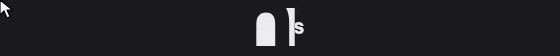

**Rodapé**

| | | |
| :---: | --- | --- |
| 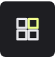 | **Templates** | Abre a janela de [templates](#templates). |
|  | **Buscar texto** | Abre a janela de [busca](#busca) nos layers de texto. |
|  | **Salvar preview .png** | Salva o frame atual da comp em .png. Botão direito: salva junto ao projeto. |
| 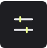 | **Preferências** | Abre a janela de [preferências](#preferências). |

---

## seções e ferramentas

Os ícones aparecem aqui ampliados, com o traço de destaque na cor de cada seção. Na barra eles são menores e ficam cinza até o mouse passar por cima.

**Precisa de**:
- **comp** — uma comp aberta na timeline;
- **layers** — layers selecionados na timeline (o número indica o mínimo);
- **comps no projeto** — comps selecionadas no painel de projeto.

###  Controles

Para montar hierarquias de parent sem caçar layers na timeline.

| | ferramenta | como usar | precisa de |
| :---: | --- | --- | :---: |
|  | **Null pai** | Selecione os layers e clique: cada um ganha um null pai na própria posição. Sem seleção, cria um null no centro da comp. O tipo de null (solid ou shape) vem das [preferências](#preferências). | comp |
|  | **Null centralizado** | Cria **um** null no centro de todos os layers selecionados e o define como pai deles. Bom para mover um grupo inteiro. | layers · 2 |
|  | **Selecionar pai** | Sobe na hierarquia: troca a seleção pelos pais dos layers selecionados. | comp |
|  | **Selecionar filhos** | Desce na hierarquia: seleciona todos os filhos dos layers selecionados. | comp |
|  | **Null: copiar animação** | Liga e desliga (um quadradinho marca quando está ativo). Ligado, o **Null pai** leva os keyframes de transformação do layer (anchor, posição, escala, rotação) para o null. | — |
| 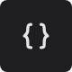 | **Null: copiar expressões** | Liga e desliga. Ligado, o **Null pai** leva também as expressões de transformação. | — |

### 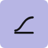 Animação

| | ferramenta | como usar | precisa de |
| :---: | --- | --- | :---: |
| 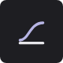 | **Influência dos keyframes** | Abre a janela de [curvas](#curvas). Desenhe a curva e aplique nos keyframes selecionados. | — |
|  | **Travar transformações** | Trava as propriedades de transformação **sem animação** dos layers selecionados, para não mexer nelas sem querer. | layers |
|  | **Randomizar layers** | Desloca cada layer selecionado por um número aleatório de frames, dentro do limite. **Botão direito:** ajusta o limite de frames. | layers · 2 |
|  | **Sequenciar layers** | Coloca os layers em escada, na ordem da seleção, com o intervalo de frames definido. **Botão direito:** ajusta o intervalo. | layers · 2 |
| 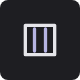 | **Guia de colunas** | Cria um layer guia com as colunas do grid da comp. | comp |
|  | **Seta** | Cria uma seta animável. Os controles ficam no *Effect Controls*. | comp |
|  | **Contador** | Cria um texto que conta de um valor a outro (número, porcentagem, tempo…). Anime o controle no *Effect Controls*. | comp |
|  | **Digitação** | Cria um texto com animação de máquina de escrever. | comp |
|  | **Palavras** | Cria um texto que entra palavra por palavra. | comp |
|  | **Tarja simples** | Cria uma tarja simples, pronta para receber texto. | comp |
|  | **Wiggle** | Põe um *wiggle* na posição dos layers selecionados, com os controles no *Effect Controls*. | layers |
|  | **IK (3 layers)** | Selecione exatamente 3 layers **em ordem** (ex.: coxa → canela → pé) e clique. Eles viram uma cadeia de parent, e um null de controle na ponta move o conjunto. | layers · 3 |

###  Efeitos

A camada de ajuste é fixa. Os outros botões são **editáveis** nas [preferências](#preferências): escolha qualquer efeito instalado, numa lista pesquisável, e um ícone ou 2 letras. Clique para aplicar o efeito nos layers selecionados. Com o **botão direito** num efeito, as preferências abrem já nele.

Botões padrão:

| | ferramenta | como usar | precisa de |
| :---: | --- | --- | :---: |
|  | **Camada de ajuste** | Cria uma adjustment layer do tamanho da comp, acima dos layers selecionados. Solid ou shape, conforme as preferências. | comp |
| 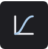 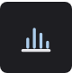  | **cor** · Curves, Levels, Lumetri Color | Aplica o efeito nos layers selecionados. | layers |
|    | **blur** · Gaussian, Compound, Lens Blur | Aplica o efeito nos layers selecionados. | layers |
|     | **outros** · Fill, 3D Glasses, Fractal Noise, Add Grain | Aplica o efeito nos layers selecionados. *Fill* e *3D Glasses* já entram configurados. | layers |

Outros ícones para escolher nas preferências:

      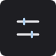 

###  Texto

Selecione layers de texto. Os outros layers da seleção são ignorados.

| | ferramenta | como usar | precisa de |
| :---: | --- | --- | :---: |
|  | **Caixa alta** | `texto` → `TEXTO` | layers |
| 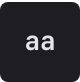 | **Caixa baixa** | `TEXTO` → `texto` | layers |
| 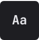 | **Primeiras maiúsculas** | `texto de exemplo` → `Texto De Exemplo` | layers |
|  | **Limpar espaços e quebras** | Tira espaços repetidos e quebras de linha, e apara as pontas. Bom para texto colado de e-mail ou PDF. | layers |
|  | **Separar colunas** | Um texto com colunas (separadas por 2+ espaços, tab ou `---`) vira um layer de texto por coluna, lado a lado. O original fica desligado. | layers |
|  | **Quebrar linhas** | Quebra as linhas a cada N caracteres, sem cortar palavras. **Botão direito:** ajusta o limite de caracteres. | layers |

###  Marca

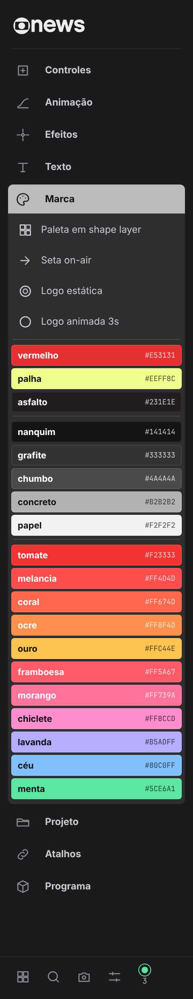

| | ferramenta | como usar | precisa de |
| :---: | --- | --- | :---: |
|  | **Paleta em shape layer** | Cria um shape layer com as amostras da paleta. Ele entra como guide e travado, só para referência. | comp |
|  | **Seta on-air** | Cria um shape layer com a seta do on-air. | comp |
|  | **Logo estática** | Cria a logo GNEWS em shape layer, editável e sem perda de resolução. | comp |
|  | **Logo animada 3s** | Cria a logo GNEWS com a animação oficial de 3 s, a partir do tempo atual da comp. | comp |

**Paleta GNEWS.** Clique numa cor para aplicar um *Fill* com ela nos layers selecionados. Na barra larga, cada cor aparece com o nome e o hex. Os grupos e as cores são **editáveis** nas [preferências](#preferências), e os nomes são gerados automaticamente, em português. Dá para renomear qualquer cor. Com o **botão direito** numa cor, a paleta abre nas preferências.

 

| grupo | cores padrão |
| --- | --- |
| **marca** |    `#E53131` `#EEFF8C` `#231E1E` |
| **neutros** |      `#141414` `#333333` `#4A4A4A` `#B2B2B2` `#F2F2F2` |
| **apoio** |            `#F23333` `#FF4D4D` `#FF674D` `#FF8F4D` `#FFC44E` `#FF5A67` `#FF739A` `#FF8CCD` `#B5ADFF` `#80C0FF` `#5CE6A1` |

###  Projeto

No alto da seção ficam dois campos: o **ID** e o **nome do projeto** (a retranca). Eles ficam gravados no próprio .aep e são usados pelas ferramentas abaixo. Preencha os dois antes de renomear ou salvar.

| | ferramenta | como usar | precisa de |
| :---: | --- | --- | :---: |
| 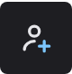 | **Inserir usuário e ID nas comps** | Selecione as comps no painel de projeto. O prefixo do usuário (das preferências), a tag PROMO e o ID entram no nome delas. | comps no projeto |
|  | **Renomear comps** | Renomeia as comps selecionadas no padrão de promo (ID + retranca). Sem seleção, renomeia todas as comps de template e de assinatura. | — |
|  | **Organizar projeto** | Cria as pastas do modelo das preferências e move cada item para a sua. Tarefa longa, com progresso. **Botão direito:** abre as [tags](#tags) para marcar itens à mão. | — |
|  | **Presets de end page** | Abre a janela de [end page](#end-page). | — |
| 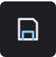 | **Salvar projeto** | Salva o .aep com o nome no padrão (ID + retranca) na pasta de projetos. **Botão direito:** escolhe outra pasta. | — |
| 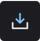 | **Coletar arquivos** | Copia para junto do projeto os arquivos usados nele (footage, imagens, áudio). Tarefa longa. | — |
| 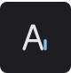 | **Coletar fontes** | Copia para junto do projeto as fontes usadas nos textos. Tarefa longa. | — |
|  | **Abrir pasta do projeto** | Abre no Explorer / Finder a pasta onde o projeto está salvo. | — |

### 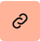 Atalhos

Sites e pastas de uso diário, com um clique. São **editáveis** nas [preferências](#preferências): ícone ou 2 letras, nome, endereço ou pasta, e ordem. Com o **botão direito** num atalho, as preferências abrem já nele.

Atalhos padrão:

| | grupo | abre |
| :---: | --- | --- |
|     | **sites** | OneDrive · Trello promo · Apontamento · Planner (no navegador) |
|   | **PAM** | para arte · magazine (pastas definidas nas preferências) |
|    | **rede** | PAM hard news · T: utilidades · peças gráficas. Ficam apagados no modo home office. |
|  | **diários · hoje** | A pasta do dia, calculada automaticamente. |

Outros ícones para escolher nas preferências:

         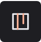

### 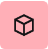 Programa

| | ferramenta | como usar | precisa de |
| :---: | --- | --- | :---: |
|  | **Fontes** | Abre a janela de [fontes](#fontes). | — |
|  | **Presets do Media Encoder** | Instala os presets de exportação de promo no Media Encoder. **Botão direito:** abre a pasta dos presets. | — |
| 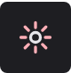 | **Setup do projeto** | Ajusta o projeto ao padrão de promo: 8 bits, Rec.709 Gamma 2.4, blending linear, timecode e expressões em JavaScript. | — |
| 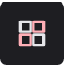 | **Cores de label** | Abre a janela de [labels](#labels). **Botão direito:** aplica o padrão PROMO direto, sem abrir a janela. | — |
| 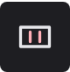 | **Setup da comp** | Ajusta a comp ativa ao padrão de promo: 1920×1080, 29,97 fps, fundo preto, work area inteira. **Botão direito:** vertical (606×1080). | comp |
|  | **Lote nunca desliga** | Gera em lote as vinhetas *nunca desliga*. Tarefa longa; clique de novo para cancelar. | — |

###  Dev

Esta seção só aparece com **ferramentas de dev** ligado nas preferências.

| | ferramenta | como usar |
| :---: | --- | --- |
|  | **Ícones .png → tema escuro** | Converte uma pasta de ícones .png para o tema escuro. |
|  | **Zipar templates** | Zipa a pasta de templates para distribuição. |
| 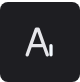 | **Zipar fontes** | Zipa a pasta de fontes para distribuição. |

---

## janelas

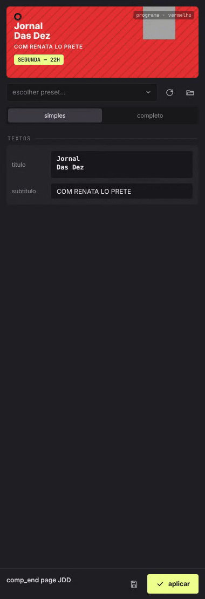

As janelas abrem pela barra e podem ficar abertas ao lado do After Effects.

**Listas pesquisáveis.** Todos os menus das janelas abrem uma lista para baixo:
1. Clique no menu.
2. Digite para filtrar (no exemplo, `hora` no formato da [end page](#end-page)).
3. Use ↑ ↓ e **Enter** para escolher, ou clique na opção. **Esc** fecha sem mudar.

A opção atual fica marcada com o losango amarelo.

 

### curvas

Abra pelo botão **Influência dos keyframes**, na seção Animação.

1. Arraste as duas alças para desenhar a curva. Os números mostram a influência de entrada e de saída. O botão de espelhar deixa as duas iguais.
2. Para copiar uma curva que já existe, selecione **1** keyframe e clique em **copiar**.
3. Escolha como aplicar:
   - **keyframes** — o After Effects interpola com essa influência;
   - **expressão** — uma expressão reproduz exatamente a curva desenhada entre os keyframes.
4. Selecione os keyframes na timeline e clique em **aplicar**.

Para tirar a expressão de curva, use o botão de remover com as propriedades selecionadas.

 

### busca

Abra pela lupa do rodapé.

1. Digite o texto. A busca roda sozinha a partir de 2 letras, ou ao apertar Enter.
   - Com uma comp selecionada, procura só nela.
   - Sem seleção, procura em todas as comps.
2. Os resultados vêm agrupados por comp, com o trecho encontrado em destaque.
3. Clique num resultado para abrir a comp e selecionar o layer.
4. Use **selecionar todos** para pegar tudo de uma vez, por exemplo para trocar a fonte.

Esc limpa a busca.

 

### templates

Abra pelo primeiro botão do rodapé.

1. **Baixar** traz a versão mais recente dos templates de PROMO. **Recarregar** relê a pasta.
2. Filtre pelo nome no campo do topo.
3. Os templates com vídeo de preview mostram uma barra fina. Passe o mouse sobre a miniatura e a posição dele escolhe o frame mostrado; nada toca sozinho.
4. Dê **duplo clique**, ou selecione e clique em **importar**, para trazer o template para o projeto.

 

### fontes

Abra pelo botão **Fontes**, na seção Programa.

1. Cada família (pasta) é um grupo. Clique no nome para ver os estilos, cada um desenhado com o próprio arquivo.
2. Para mudar o texto de exemplo, escreva no campo do topo ou direto numa amostra. O **×** limpa o campo.
3. Escolha o tamanho do exemplo: **P**, **M** ou **G**.
4. **Instalar** copia a família para as fontes do sistema.

O texto, o tamanho e os grupos abertos ficam guardados para a próxima vez.

 

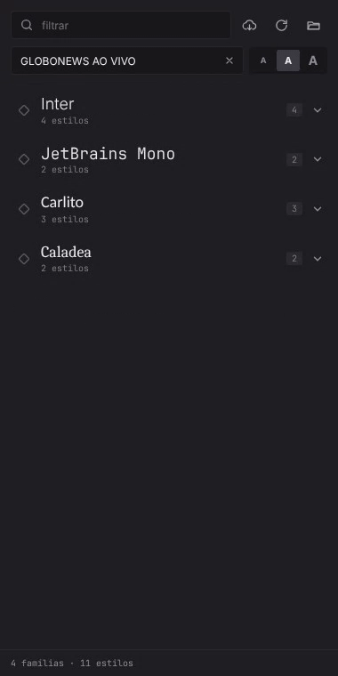

### tags

Abra com o botão direito em **Organizar projeto**.

1. Selecione itens no painel de projeto.
2. Clique numa tag para marcá-los. Ao organizar, cada item vai para a pasta da sua tag.
3. Para marcar com um nome livre, use **tag personalizada**. Aplicar com o campo vazio remove a tag.

 

### end page

Abra pelo botão **Presets de end page**, na seção Projeto.

1. Escolha um **preset**. A prévia mostra a disposição:
   - **footage** — o retângulo escuro, no fundo;
   - **foto** — o quadrado claro, por cima.
2. Escolha o modo (**simples** ou **completo**) e preencha os campos da assinatura (dia, hora…).
3. Para partir de uma end page pronta, selecione a comp dela e use o botão de **ler**: os campos se preenchem com os valores dela.
4. Clique em **aplicar** com a end page selecionada.
5. O botão de **salvar como preset** guarda a configuração atual para a equipe.

 

### labels

| paleta | editor |
| :---: | :---: |
|  | 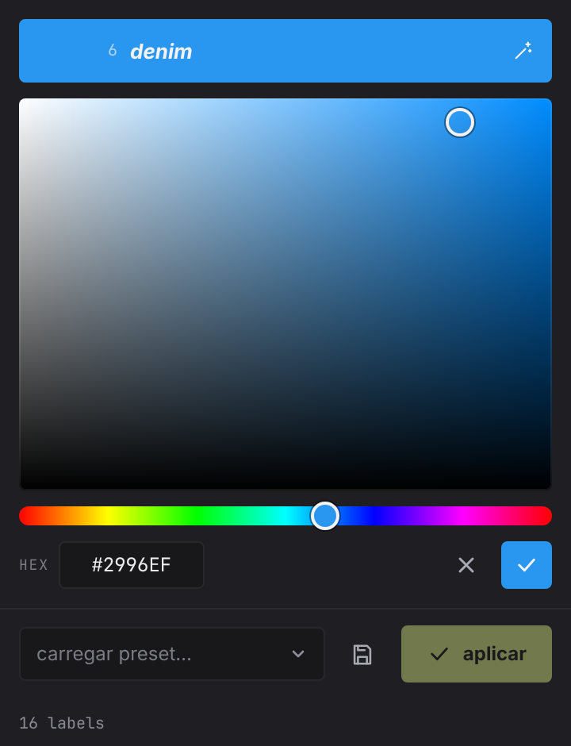 |

Abra pelo botão **Cores de label**, na seção Programa.

1. As 16 cores de label aparecem como amostras, cada uma com número, nome e hex.
2. Clique numa amostra e o editor toma a janela:
   - à esquerda fica a cor gravada (clique nela para voltar);
   - ao lado fica a nova cor, com o nome gerado automaticamente — dá para editar o nome, e a varinha gera de novo;
   - escolha a cor no quadrado de saturação × brilho e na barra de matiz, ou digite o hex.
3. Confirme com **ok** (Enter) ou cancele (Esc). As cores alteradas ganham um keyframe amarelo até você clicar em **aplicar**.
4. Em **carregar preset…** troque tudo de uma vez: PROMO, padrão da Adobe ou os seus.
5. Para salvar a combinação atual, dê um nome e use **salvar como preset**. Os seus presets podem ser removidos.

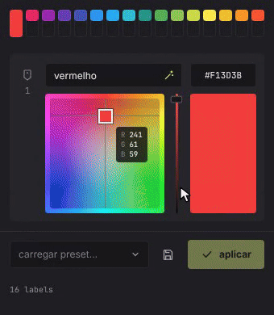

---

## preferências

Abra pelo último botão do rodapé. As mudanças valem na hora, sem botão de salvar.

- **usuário** — o prefixo usado nos IDs e nos nomes.
- **modos** — **home office** usa templates e fontes locais e apaga os atalhos de rede; **hard news** troca IDs, pastas e previews para o padrão do HN.
- **layers** — null e camada de ajuste em solid ou shape.
- **projeto** — pastas de organização (siglas e pastas, editáveis), ignorar arquivos faltando ao coletar, pasta dos projetos.
- **rede** — pastas do PAM (para arte, magazine).
- **efeitos**, **atalhos** e **paleta** — o que a barra mostra nessas seções.
- **painel** — rótulos no painel largo, animações reduzidas, ferramentas de dev.

No rodapé da janela ficam **abrir pasta de preferências** e **restaurar padrões**.

 

### o que a barra mostra é editável

Clique com o **botão direito** num atalho, numa cor ou num efeito da barra: as preferências abrem já rolando até ele.

| atalhos | paleta | efeitos |
| :---: | :---: | :---: |
| 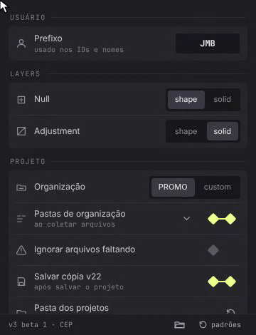 | 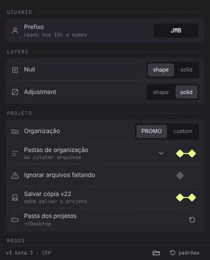 | 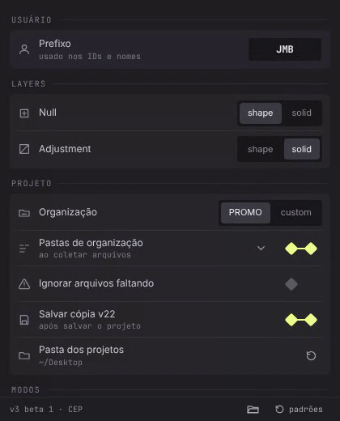 |
| Ícone ou 2 letras, nome e destino (site ou pasta). Arraste para reordenar. | Grupos de cores em hex, com prévia ao lado. Use **+ cor** e **+ grupo**. O nome é automático (em cinza): clique nele para renomear; apague, ou use Esc, para voltar ao automático. | Grupos de efeitos. Escolha qualquer efeito instalado numa lista pesquisável e dê um ícone a ele. |

Cada lista tem **restaurar** para voltar ao padrão.

---

## desenvolvimento

Estrutura do código, instalação de desenvolvimento (macOS / Windows), build e cuidados com o ExtendScript: [cep/README.md](cep/README.md).

As imagens desta página são geradas a partir da própria interface:
`node tools/doc-icons.js` (ícones) · `node tools/doc-shots.js` (capturas) · `node tools/doc-gifs.js` (gifs).
