# PROMO GNEWS

**pt-BR** ⚡ extensão do After Effects com as ferramentas da equipe de motion em PROMO na 

After Effects 2022 ou mais novo, no **Windows e no macOS**: uma barra em sanfona com as ferramentas do dia a dia e janelas próprias para as tarefas maiores.

- [instalar](#instalar)
- [a barra](#a-barra)
- [seções e ferramentas](#seções-e-ferramentas)
- [janelas](#janelas)
- [desenvolvimento](#desenvolvimento)

---

## instalar

1. abra o After Effects e vá em *File › Scripts › Run Script File…*
2. escolha `INSTALAR PROMO GNEWS.jsx`, na pasta do PROMO GNEWS na rede (a que tem as pastas `cep` e `source`)
3. se tudo estiver ok, o instalador abre direto em **instalar** / **atualizar**. se faltar algo, ele mostra o quê — e deixa escolher a pasta, caso não encontre
4. reinicie o After Effects e abra *Window › Extensions › PROMO GNEWS*

> o código fica na rede: para atualizar, basta trocar os arquivos lá e reabrir o painel. o instalador só precisa rodar de novo quando a equipe avisar.\
> se algo parecer antigo, rode `tools/diagnostico.jsx` (*Run Script File…*): ele lista as cópias instaladas e aponta as desatualizadas.

---

## a barra

a barra é uma **sanfona**: cada seção é um ícone; ao abrir, as ferramentas da seção aparecem logo abaixo (ou ao lado, na barra horizontal).

- **vertical ou horizontal** — redimensione o painel: estreito mostra só ícones, largo mostra os nomes, baixo e largo vira uma barra horizontal (com 1 ou 2 linhas de ferramentas)
- **tooltips** — pare o mouse em cima de um botão para ver o nome
- **botão direito** — variações de algumas ferramentas (ex.: definir pasta, abrir tags, ajustar quantidade de frames)
- **tarefas longas** (organizar, coletar, batch) mostram o progresso no próprio botão, numa linha no rodapé e na porcentagem do indicador de seleção. clique de novo para cancelar
- **seleção** — o indicador no canto mostra quantos layers estão selecionados (verde = comp ativa). ferramentas que precisam de seleção ficam apagadas sem ela. a bolinha fica **vermelha** quando a rede está fora ou quando a barra antiga ainda está instalada (o motivo aparece no tooltip)

 

**logo** — passe o mouse sobre a logo: a animação oficial acompanha a posição do mouse, como o thumbnail do Premiere.

na horizontal, quando o painel é baixo e largo:

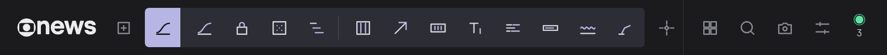

---

## seções e ferramentas

ícones ampliados e com o traço de destaque na cor de cada seção — na barra eles aparecem menores, em cinza, e ganham a cor ao passar o mouse.

###  Controles

| | ferramenta | o que faz | precisa de | botão direito |
| :---: | --- | --- | --- | --- |
|  | **Null parent** | cria um null pai na posição de cada layer selecionado (sem seleção: no centro da comp). o tipo de null (solid ou shape) vem das preferências. | comp ativa |  |
|  | **Null centralizado** | cria **um** null pai no centro geométrico de 2 ou mais layers selecionados. | 2+ layers |  |
|  | **Selecionar parent** | sobe na hierarquia: seleciona o pai dos layers selecionados. | comp ativa |  |
|  | **Selecionar children** | desce na hierarquia: seleciona todos os filhos dos layers selecionados. | comp ativa |  |
|  | **Null: copiar animação** | modificador do **null**: leva os keyframes de transformação (anchor, posição, escala, rotação) para o null. |  |  |
|  | **Null: copiar expressões** | modificador do **null**: leva as expressões de transformação para o null. |  |  |

###  Animação

| | ferramenta | o que faz | precisa de | botão direito |
| :---: | --- | --- | --- | --- |
|  | **Influência dos keyframes** | abre a janela de **curvas**: edita a influência dos keyframes e aplica por keyframes ou por expressão. |  |  |
|  | **Travar transformações** | tranca todas as propriedades de transformação **não animadas** dos layers selecionados. | layers |  |
|  | **Randomizar layers** | desloca a entrada e a saída de cada layer selecionado em tempos aleatórios. | 2+ layers | ajusta frames |
|  | **Sequenciar layers** | sequencia os layers selecionados, um depois do outro. | 2+ layers | ajusta frames |
|  | **Guia de colunas** | cria um guia de colunas na comp. | comp ativa |  |
|  | **Seta** | preset de seta com controles no *effect controls*. | comp ativa |  |
|  | **Contador** | rig de contagem num layer de texto (número, porcentagem, tempo…), com controles no *effect controls*. | comp ativa |  |
|  | **Typewriter** | lettering com animação de digitação. | comp ativa |  |
|  | **Palavras** | lettering com animação palavra por palavra. | comp ativa |  |
|  | **Tarja simples** | cria uma tarja simples. | comp ativa |  |
|  | **Wig** | rig de *wiggle* na posição dos layers selecionados, com controles. | layers |  |
|  | **IK (3 layers)** | IK simples com 3 layers selecionados **em ordem** (ex.: coxa → canela → pé). | 3+ layers |  |

###  Efeitos

a camada de ajuste é fixa; os **efeitos e seus grupos são editáveis** nas preferências — escolha qualquer efeito instalado numa lista pesquisável e um ícone (ou 2 letras). botão direito num efeito abre as preferências já nele. padrão:

| | ferramenta | o que faz | precisa de | botão direito |
| :---: | --- | --- | --- | --- |
|  | **Adjustment layer** | adjustment layer do tamanho da comp (solid ou shape, nas preferências). | comp ativa |  |
|  | **Curves** | aplica *Curves* nos layers selecionados. | layers |  |
| 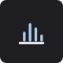 | **Levels** | aplica *Levels*. | layers |  |
|  | **Lumetri Color** | aplica *Lumetri Color*. | layers |  |
|  | **Gaussian Blur** | aplica *Gaussian Blur*. | layers |  |
|  | **Compound Blur** | aplica *Compound Blur*. | layers |  |
|  | **Lens Blur** | aplica *Lens Blur*. | layers |  |
|  | **Fill** | aplica *Fill*. | layers |  |
|  | **3D Glasses** | aplica *3D Glasses*. | layers |  |
|  | **Fractal Noise** | aplica *Fractal Noise*. | layers |  |
|  | **Add Grain** | aplica *Add Grain*. | layers |  |

###  Texto

| | ferramenta | o que faz | precisa de | botão direito |
| :---: | --- | --- | --- | --- |
|  | **Caixa alta** | converte os textos selecionados para CAIXA ALTA. | layers |  |
|  | **Caixa baixa** | converte para caixa baixa. | layers |  |
|  | **Title case** | converte para Title Case. | layers |  |
|  | **Limpar espaços e quebras** | remove espaços repetidos e quebras de linha e apara o texto. | layers |  |
|  | **Separar colunas** | separa um texto em colunas: cada coluna vira um novo layer de texto. | layers |  |
|  | **Quebrar linhas** | quebra as linhas a partir de um limite de caracteres. | layers | ajusta caracteres |

###  Marca

| | ferramenta | o que faz | precisa de | botão direito |
| :---: | --- | --- | --- | --- |
|  | **Paleta em shape layer** | shape layer com as amostras da paleta (guide layer, travado). | comp ativa |  |
|  | **Seta on-air** | shape layer com a seta do on-air. | comp ativa |  |
|  | **Logo estático** | shape layer com a logo GNEWS estática. | comp ativa |  |
|  | **Logo animado 3s** | shape layer com a logo GNEWS animada (3 s), a partir do tempo atual da comp. | comp ativa |  |

**paleta GNEWS** · aplica um *Fill* com a cor nos layers selecionados. os grupos e as cores são **editáveis** nas preferências (hex em texto, + cor, + grupo); os nomes são automáticos, em português. na barra larga cada cor aparece com nome e hex. botão direito numa cor abre a paleta nas preferências. padrão:

    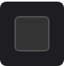 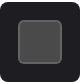 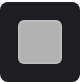 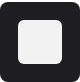 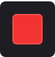 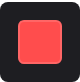 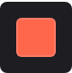 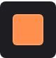 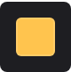 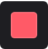 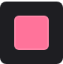 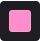 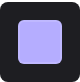 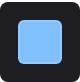 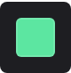

`#E53131` `#EEFF8C` `#231E1E` `#141414` `#333333` `#4A4A4A` `#B2B2B2` `#F2F2F2` `#F23333` `#FF4D4D` `#FF674D` `#FF8F4D` `#FFC44E` `#FF5A67` `#FF739A` `#FF8CCD` `#B5ADFF` `#80C0FF` `#5CE6A1`

###  Projeto

| | ferramenta | o que faz | precisa de | botão direito |
| :---: | --- | --- | --- | --- |
|  | **Inserir usuário e ID nas comps** | insere usuário, tag PROMO e ID do projeto no nome das comps selecionadas. |  |  |
|  | **Renomear comps** | renomeia comps de templates e assinaturas no padrão de nomenclatura de promo. |  |  |
|  | **Organizar projeto** | cria e organiza as pastas do projeto pelo modelo das preferências (tarefa longa, com progresso). |  | tags de organização |
|  | **Presets de end page** | abre a janela de **end page**: presets, layout e textos da assinatura. |  |  |
|  | **Salvar projeto** | salva o projeto no padrão de nomenclatura (ID + retranca). |  | salvar em outra pasta |
|  | **Coletar arquivos** | coleta os arquivos usados no projeto. |  |  |
|  | **Coletar fontes** | coleta as fontes usadas no projeto. |  |  |
|  | **Abrir pasta do projeto** | abre a pasta do projeto. |  |  |

###  Programa

| | ferramenta | o que faz | precisa de | botão direito |
| :---: | --- | --- | --- | --- |
|  | **Fontes** | abre a janela de **fontes**: baixa e instala as fontes do on-air. |  |  |
|  | **Presets do Media Encoder** | instala os presets de exportação no Media Encoder. |  | abrir pasta de presets |
|  | **Setup do projeto** | setup do projeto (preferências de projeto padrão de promo). |  |  |
|  | **Cores de label** | abre a janela de **labels**: cores e nomes dos 16 labels. |  | aplicar o padrão PROMO direto |
|  | **Setup da comp** | setup da comp ativa no padrão de promo. | comp ativa | vertical |
|  | **Batch nunca desliga** | batch das vinhetas *nunca desliga* (tarefa longa, com progresso). |  |  |

###  Dev

| | ferramenta | o que faz | precisa de | botão direito |
| :---: | --- | --- | --- | --- |
|  | **Ícones .png → tema escuro** | converte ícones .png para o tema escuro. |  |  |
|  | **Zipar templates** | zipa a pasta de templates. |  |  |
|  | **Zipar fontes** | zipa a pasta de fontes. |  |  |

###  Atalhos

sites e pastas de uso diário — **editáveis** nas preferências (ícone ou 2 letras, nome, endereço / pasta, ordem). botão direito em um atalho abre as preferências já nele.

| | padrão | abre |
| :---: | --- | --- |
|     | **sites** | OneDrive, Trello promo, Apontamento, Planner |
|   | **PAM** | para arte · magazine (pastas definidas nas preferências) |
|    | **rede** | PAM hard news · T: utilidades · peças gráficas — indisponíveis no modo home office |
|  | **diários · hoje** | a pasta do dia, calculada automaticamente |

### rodapé

| | | |
| :---: | --- | --- |
|  | **templates** | janela de templates |
|  | **buscar texto** | janela de busca nos layers de texto |
|  | **preview .png** | salva o frame atual da comp em .png · botão direito: junto ao projeto |
|  | **preferências** | janela de preferências |

---

## janelas

| curvas | busca | templates | fontes |
| :---: | :---: | :---: | :---: |
| 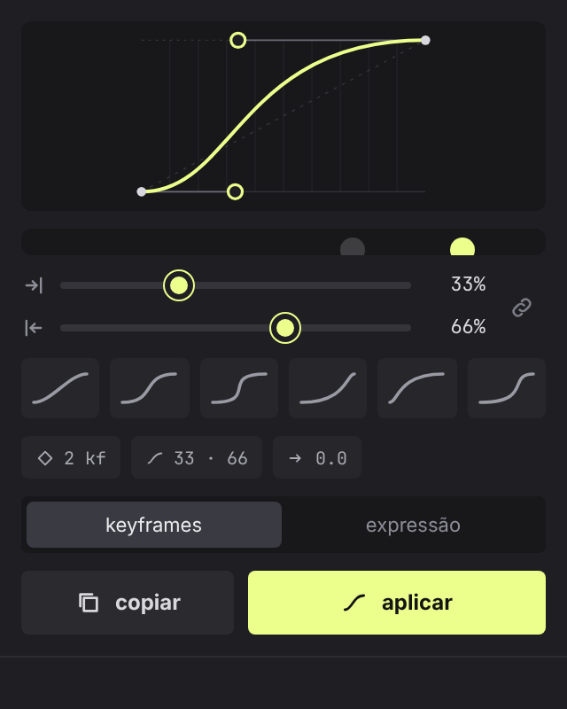 | 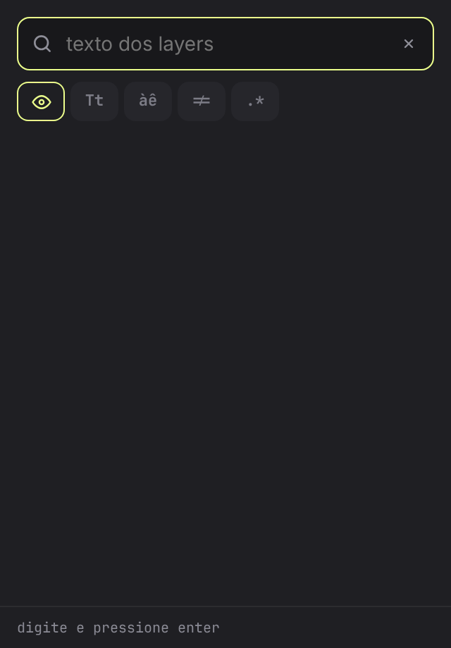 | 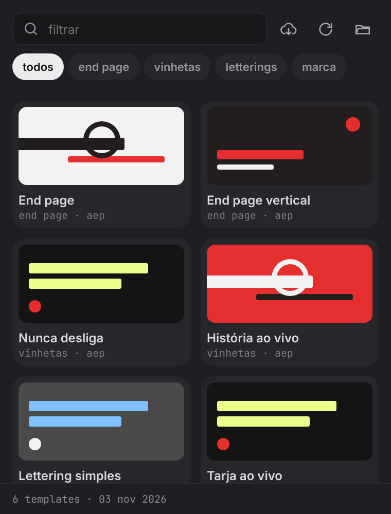 | 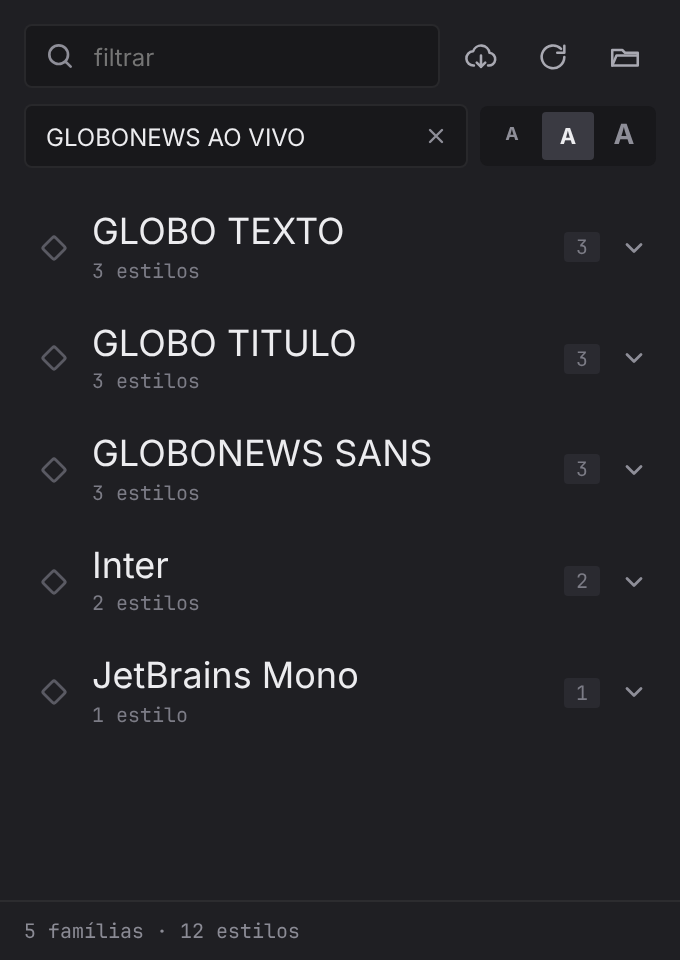 |
| influência dos keyframes; aplica por **keyframes** ou por **expressão** (a mesma curva) | busca no conteúdo dos layers de texto (sem comp selecionada: em todas) | baixa, lista e importa os templates de PROMO, com filtro | famílias em grupos com o preview de cada estilo; baixa e instala as fontes do on-air |

| tags | end page | labels | preferências |
| :---: | :---: | :---: | :---: |
| 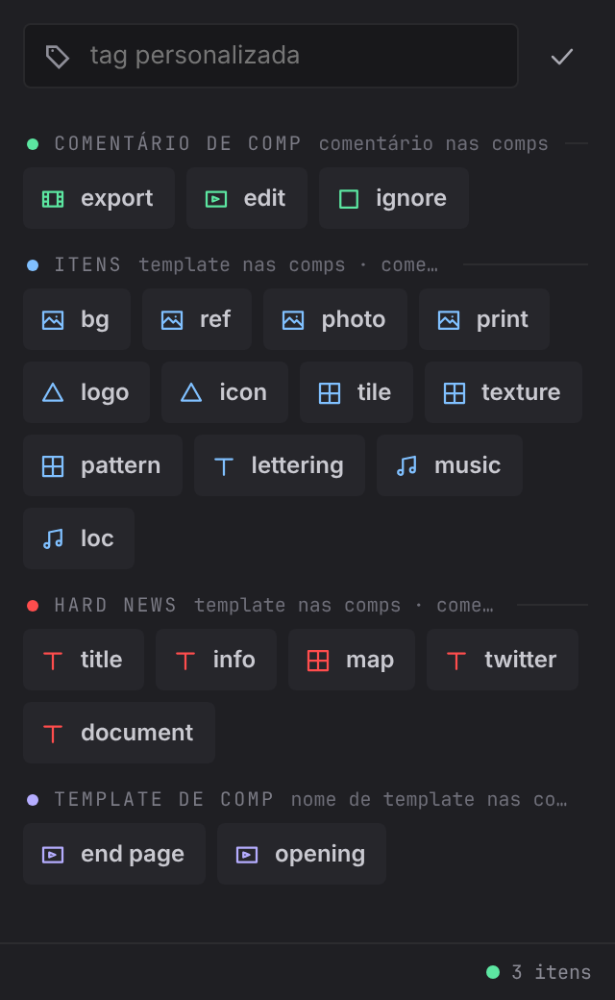 | 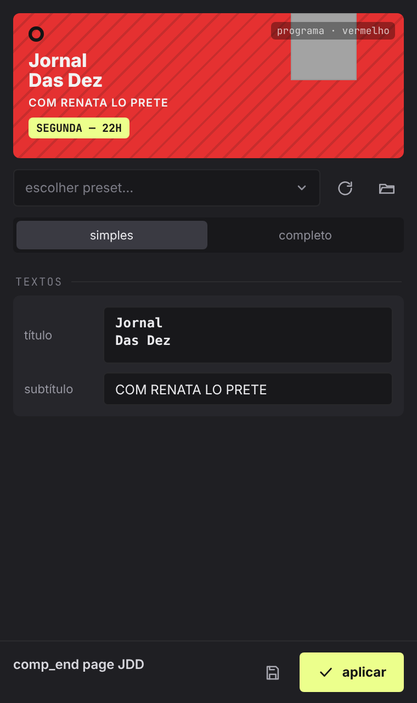 | 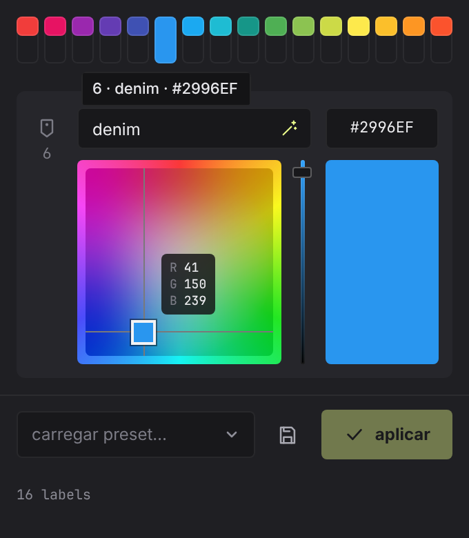 | 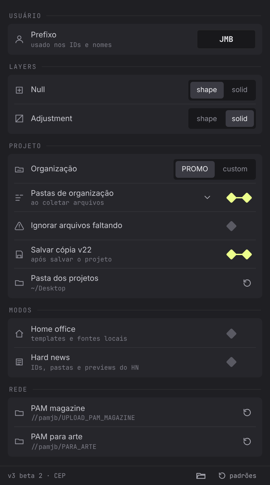 |
| tags de organização nos itens do projeto | presets, layout e textos da assinatura | as 16 cores de label, com nome automático e presets próprios | usuário, layers, projeto, pastas, **atalhos** e painel |

**labels** — trocar de cor em cascata, escolher matiz/saturação no quadrado e o brilho no slider:

**listas** — todo menu das janelas estica para baixo e é pesquisável (digite para filtrar, ↑ ↓ Enter):

**fontes** — cada família (pasta) abre os seus estilos, cada um no próprio arquivo; edite o texto de preview no campo ou direto numa amostra (× limpa), tamanho P / M / G:

**preferências** — o que a barra mostra é editável:

| atalhos | paleta | efeitos |
| :---: | :---: | :---: |
|  |  |  |
| ícone ou letras, nome, destino, arraste para reordenar | grupos de cores em hex, + cor, nomes automáticos | qualquer efeito instalado, numa lista pesquisável |

---

## desenvolvimento

estrutura do código, instalação de desenvolvimento (macOS / Windows), build e cuidados com o ExtendScript em [cep/README.md](cep/README.md).

imagens desta página: `node tools/doc-icons.js` (ícones) · `node tools/doc-gifs.js` (gifs) — geradas a partir da própria interface.
