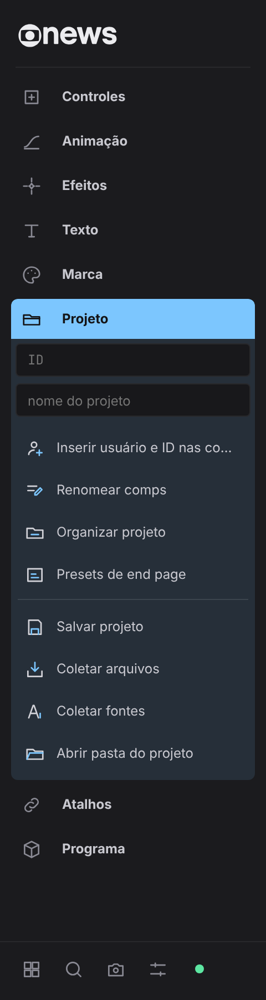
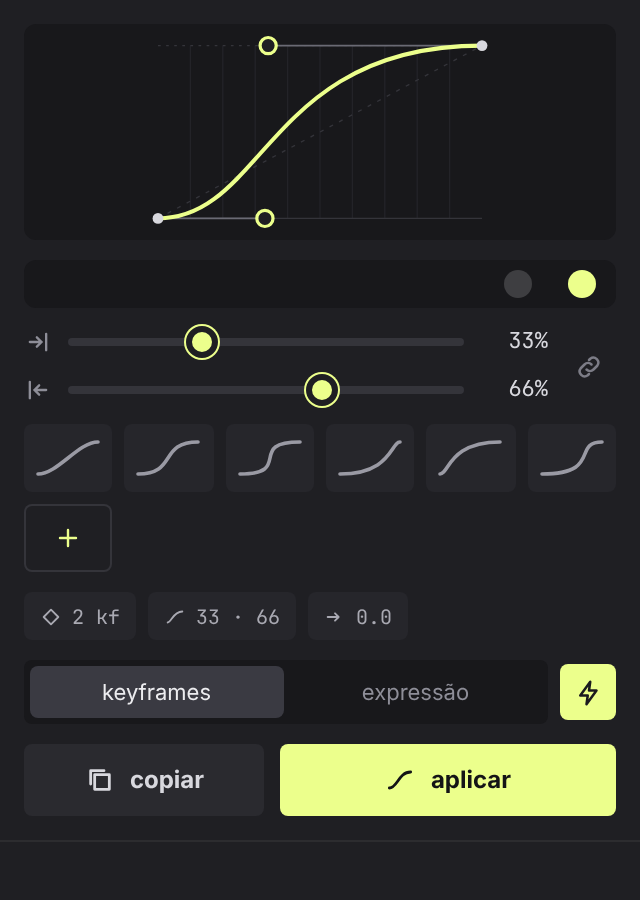
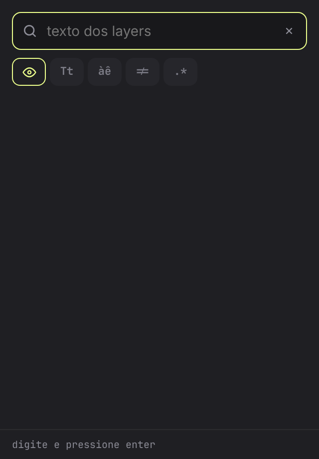
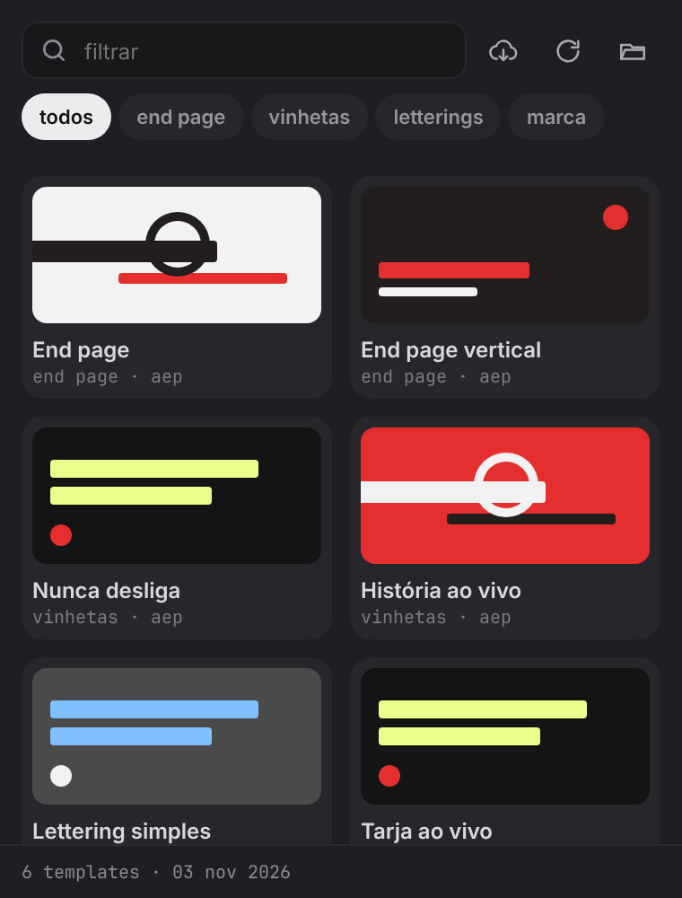
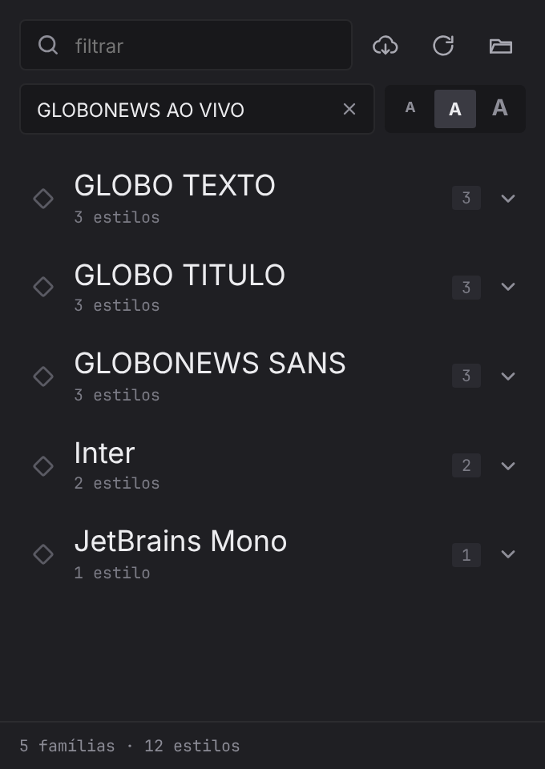
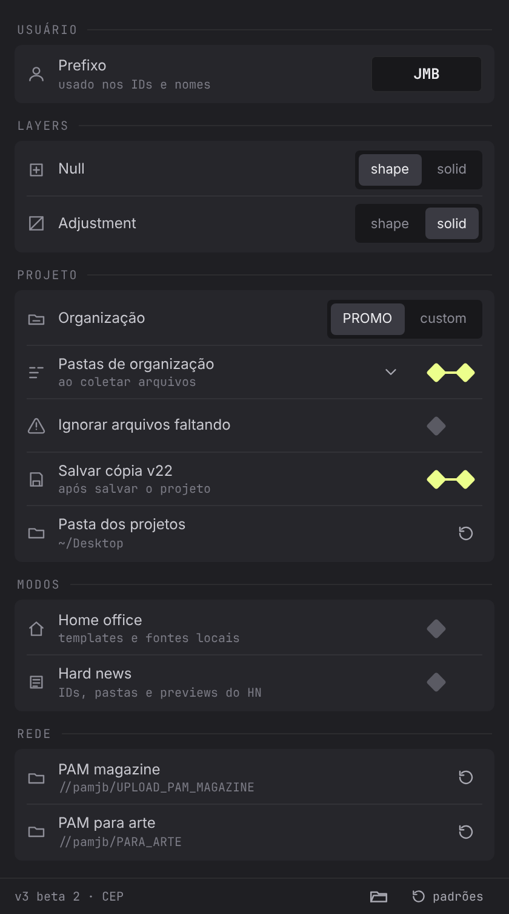
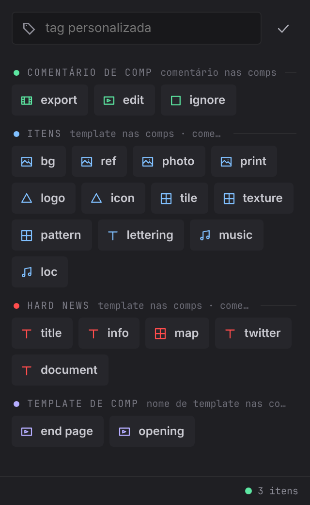
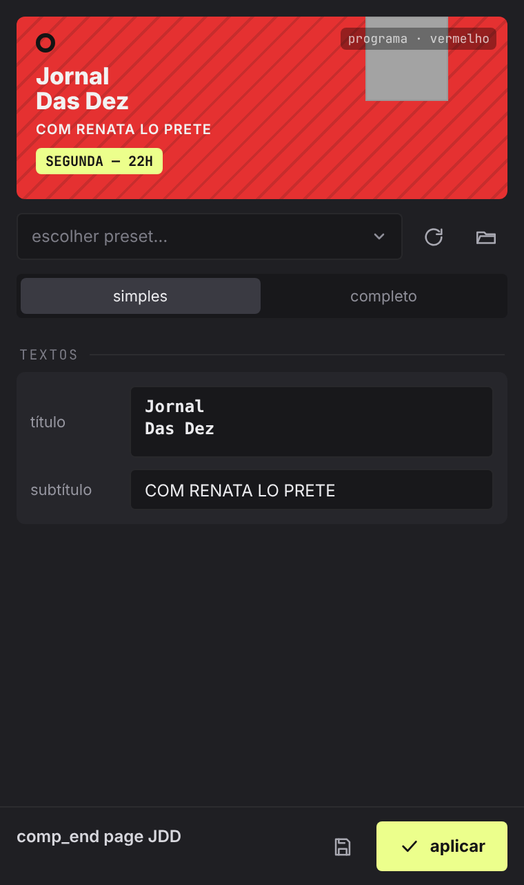
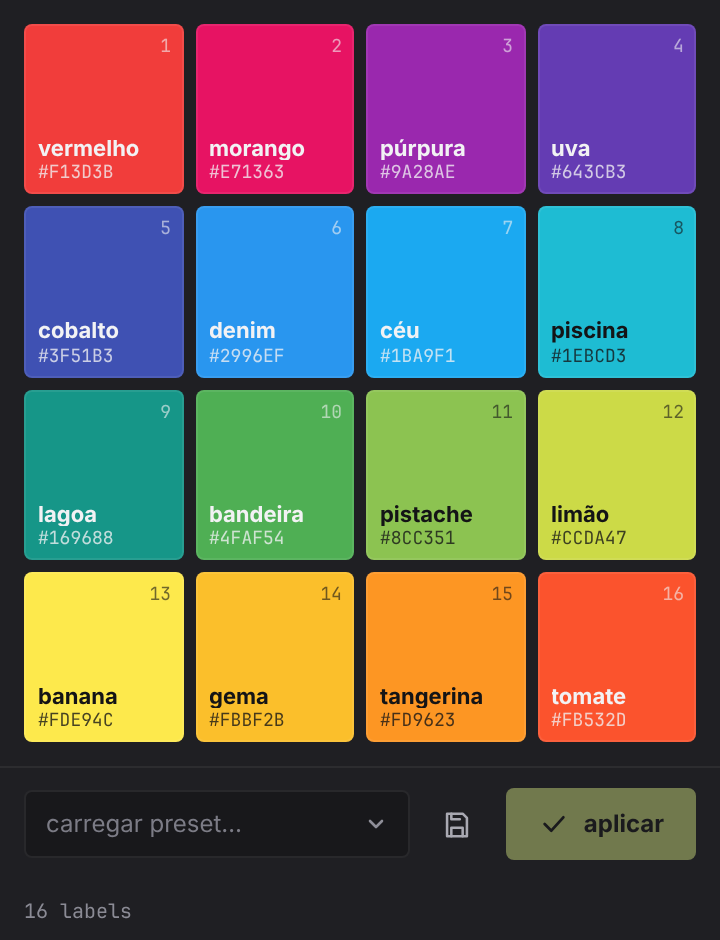

# PROMO GNEWS · extensão CEP

Extensão para **After Effects 2022 ou mais recente**, no **Windows e no macOS**. A interface é HTML (`cep/client`); a lógica roda no After Effects (`cep/host`) e usa as bibliotecas de `source/` (globals, funções, expressões, shape templates e rigs).

```
INSTALAR PROMO GNEWS.jsx     instalador da equipe (rodar de dentro do After Effects)
cep/
  CSXS/manifest.xml          painel + 8 janelas (curvas, busca, templates, fontes, preferências, tags, end page, labels)
  loader/stub.html           página instalada na máquina: abre a página de verdade na rede
  host/loader.jsx            confere se o host mudou na rede e manda recarregar
  host/index.jsx             carrega source/ (globals + libraries), platform.jsx, core.jsx e os tools (nenhuma janela ScriptUI)
  host/platform.jsx          macOS × Windows: caminhos de rede, montagem de volumes, zip, fontes, clipboard
  host/core.jsx              PGN.register / PGN.run / PGN.fail · tarefas em passos (PGN.registerJob)
  host/tools/*.jsx           uma ferramenta por id (porte das abas do script)
  client/shared/             visual (base.css), ponte com o AE (bridge.js), helpers (ui.js)
  client/panel/              barra em sanfona (tools.js = registro das ferramentas)
  client/windows/*/          janelas próprias
  scripts/                   instaladores de desenvolvimento (macOS / Windows)
source/                      globals + bibliotecas usadas pelo host (funções, expressões, shape templates, rigs)
downloads/                   templates, fontes e presets do AME baixados pelo host quando faltam
tools/                       build-cep.js (pacote / instalação de dev) · gnews-logo.js (logo animada do painel)
                             diagnostico.jsx (lista as cópias instaladas e quais ainda têm código antigo)
                             doc-icons.js · doc-gifs.js (ícones e gifs do README, gerados da própria interface)
```

## Interface

| barra (fechada · aberta) | | curvas | busca | templates |
| :---: | :---: | :---: | :---: | :---: |
|  |  |  |  |  |

| fontes | preferências | tags | end page | labels |
| :---: | :---: | :---: | :---: | :---: |
|  |  |  |  |  |

- **Barra:** sanfona com as seções do script. Fica na vertical ou, quando o painel é baixo e largo, na horizontal (a seção aberta se desdobra para a direita). Tarefas longas mostram o progresso na própria barra.

  
- **Curvas:** edita a curva de easing e aplica com keyframes ou por expressão (mesma curva).
- **Busca, templates, fontes:** listas com filtro. A seleção é marcada pelo keyframe amarelo.
- **Menus:** todo `select.fld` das janelas vira um dropdown pesquisável (`UI.dropdown`, em `shared/ui.js`).
- **Preferências:** usuário, layers, projeto (pastas de organização num editor de árvore), modos e **atalhos** (salvos em `shortcuts.json`).
- **Tags:** marca layers e comps para a organização do projeto.
- **End page:** presets, layout e textos da end page.
- **Labels:** as 16 cores dos labels de layer, com seletor de cor, nome automático pela cor e presets próprios (salvos em `labels presets.json`, na pasta de preferências do script).

Visual: fundo escuro, amarelo GNEWS (`#ECFF8C`) como único destaque, seleção e foco em linhas finas, sem brilhos nem gradientes. Os prints acima foram tirados no navegador com dados simulados (`PGN.mock`).

## Instalar (equipe)

1. Na pasta do PROMO GNEWS na rede (a mesma estrutura deste repositório, com `cep/` e `source/`), abra o After Effects e vá em *File › Scripts › Run Script File…*.
2. Escolha `INSTALAR PROMO GNEWS.jsx`. Se tudo estiver ok, ele abre direto em *instalar* / *atualizar*. Se não, mostra o que falta.
3. Reinicie o After Effects e abra *Window › Extensions › PROMO GNEWS*.

O instalador faz três coisas:
- grava na máquina só um **carregador**: o manifest e uma página por painel ou janela;
- liga o `PlayerDebugMode` (CSXS 7 a 13);
- se você marcar a opção, remove o script ScriptUI antigo.

O código continua na rede. Para atualizar, basta trocar os arquivos lá e reabrir o painel. O instalador só precisa rodar de novo quando o `manifest.xml` mudar.

No macOS, o carregador procura a pasta da rede também nos volumes com sufixo (`/Volumes/cdesign-1` a `-5`). O host converte os caminhos UNC (`//servidor/share/...`) e as letras de drive para `/Volumes/...`, e monta o volume quando uma ferramenta precisa dele.

## Desenvolver

- **macOS:** `./cep/scripts/install-mac.sh` cria links para a pasta `cep` e para os fontes. Com `--copy` faz uma cópia fixa e com `--uninstall` remove.
- **Windows:** `powershell -ExecutionPolicy Bypass -File cep\scripts\install-win.ps1` faz uma cópia. Com `-Link` usa uma junção para o repositório e com `-Uninstall` remove.
- **Com Node:** `node tools/build-cep.js --dev` faz o mesmo que a instalação por link. `node tools/build-cep.js` gera `dist/com.promognews.cep`, uma pasta completa para assinar com o `ZXPSignCmd`.

Depois de editar:
- **HTML/CSS/JS:** feche e abra o painel.
- **`.jsx`:** reabra o painel. O carregador percebe a mudança e recarrega o host, sem reiniciar o After Effects.
- **`manifest.xml`:** reinicie o After Effects.

Para depurar, abra o DevTools no Chrome em `localhost:8091` (painel) ou nas portas 8092 a 8099 (janelas). As portas estão em `cep/.debug`.

As páginas também abrem direto no navegador, sem o After Effects. Nesse caso, toda chamada é simulada (`PGN.mock`), o que serve para ajustar o visual.

## Como funciona

- **Ferramentas:** cada botão chama `PGN.run(id, args)` no host. A resposta é `{ ok, msg, data }` ou `{ ok: false, error }`, e a mensagem também aparece no painel *Info* do After Effects.
- **Tarefas longas** (organizar, coletar arquivos/fontes, batch): rodam em passos curtos (`PGN.registerJob`). O painel chama um passo de cada vez e anima o progresso entre as chamadas:
  - anel no botão;
  - linha no rodapé;
  - porcentagem no indicador de seleção;
  - etapa em texto, quando o painel tem espaço.

  Clicar de novo no botão cancela a tarefa.
- **Botão direito:** chama a variante da ferramenta (`args.alt`). Em organizar projeto, abre a janela de tags. Em randomizar, sequenciar e quebrar linhas, abre um ajuste de valor dentro da sanfona.
- **Seleção:** o painel consulta a seleção (`PGN.status`) a cada 1,2 s e apaga as ferramentas que precisam de comp ou de layers.
- **Janelas:** são extensões `Modeless`. Elas reusam o mesmo engine do host e avisam o painel por eventos CEP (`com.promognews.toast`, `com.promognews.prefs`).
- **Dev:** a seção *Dev* aparece quando *ferramentas de dev* está ligado nas preferências.

### Cuidados (os mesmos do O PADEIRO)

- **Manifest:** usa `RequiredRuntime` CSXS **7.0** e os parâmetros `--enable-nodejs --mixed-context`. Sem isso, no After Effects 2025 para macOS, as janelas abertas com o After Effects já rodando ficam pretas.
- **ExtendScript é ES3:** nada de `let`, `const`, *arrow functions* ou template strings. Ternários encadeados (`a ? b : c ? d : e`) são avaliados como `(a ? b : c) ? d : e`, então use `if`/`else`.
- **Codificação:** os `.jsx` do host usam UTF-8 com BOM. Acentos em strings ficam como `\uXXXX`.

### macOS: o que saber

- **Caminhos de rede:** caminhos UNC (`//servidor/share/...`), letras de drive (`T:`) e `smb://` viram `/Volumes/<share>/...`, com os sufixos `-1` a `-5` resolvidos. Os mapas ficam em `host/platform.jsx` (`PGN.net.SHARES`, `DRIVE_MAP`).
- **Montagem:** nada é montado ao abrir o painel. As ferramentas que precisam da rede (atalhos, templates, fontes, end page, salvar/coletar) montam o volume na hora, com `mount volume "smb://corp\usuário@servidor/share"`. Se o login do Mac não for o da rede, o Finder pede a senha.
- **Rede fora do ar:** o aviso que o script clássico mostrava ao iniciar ("drive N: is not available…") vira uma mensagem no painel, sem bloquear.
- **Fontes:** são instaladas em `~/Library/Fonts`. O After Effects só lista as novas fontes depois de reiniciar.
- **Zip:** usa `ditto`/`zip`, e os templates zipados no Windows (com `\` nos nomes) são reorganizados em pastas.
- **Download:** usa `curl`. Se a rede da empresa exigir proxy, o download pode falhar.
